

  <picture>
    <source media="(prefers-color-scheme: dark)" srcset=".github/assets/banner-dark.png">
    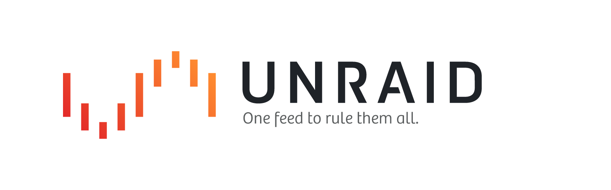
  </picture>

  &nbsp;
  &nbsp;
  &nbsp;
  &nbsp;
  

Unraid <b>Community Applications</b> templates for junkerderprovinz's containers and most of the plugins, grouped like the profile: <b>Apps</b> (my own software), <b>Images</b> (my own image builds of third-party apps), <b>Wrappers</b> (thin templates over an upstream image) and <b>Plugins</b>. One repository, one CA feed; each app's image and full source live in its own per-app repository.

## Apps

*My own software, built and published by junkerderprovinz. Full docs live in each app's own repository.*

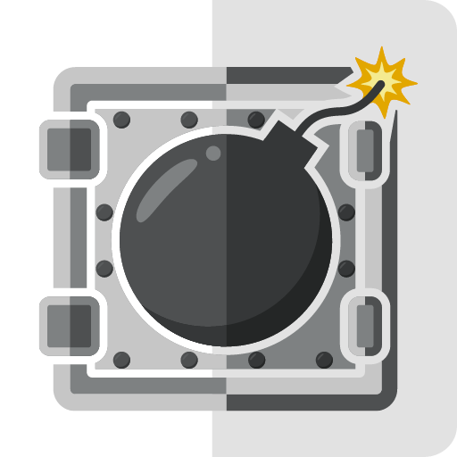

**[BombVault](https://github.com/junkerderprovinz/bombvault#readme)** · [Docker compose](https://github.com/junkerderprovinz/bombvault/blob/main/deploy/docker-compose.generic.yml) 
Backup and full disaster recovery for containers, VMs and the flash, powered by restic, with one-click backup and cross-server restore.

 

**[CastleParcel](https://github.com/junkerderprovinz/castleparcel#readme)** · [Docker compose](https://github.com/junkerderprovinz/castleparcel/blob/main/compose.yaml) 
The big-file transfer site you know, on your own server and sealed: encrypted in your browser, with an optional owner sign-in, self-expiring share links, file requests and notes.

 

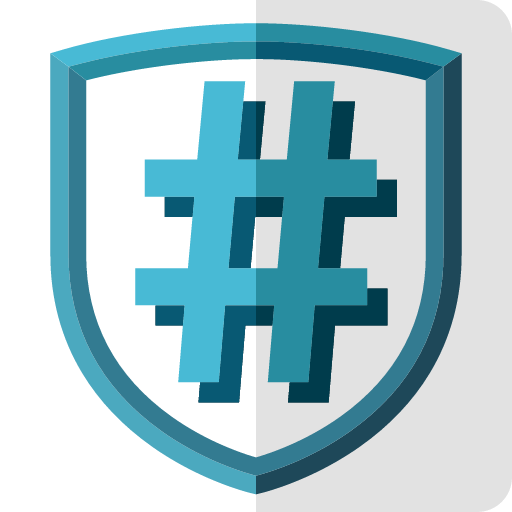

**[TrickWork](https://github.com/junkerderprovinz/trickwork#readme)** · [Docker compose](https://github.com/junkerderprovinz/trickwork/blob/main/compose.yaml) 
Turns images into proportional-font-aware ASCII art - a rebuild of ASCII Gen 2, picking characters by real ink coverage, not brightness.

 

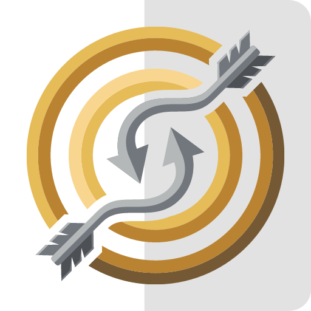

**[ArrowLoop](https://github.com/junkerderprovinz/arrowloop#readme)** · [Docker compose](https://github.com/junkerderprovinz/arrowloop/blob/main/compose.yaml) 
Two-way file sync that shows you the plan before it touches a file, sends deletions to a trash and stops a run that would delete too much.

 

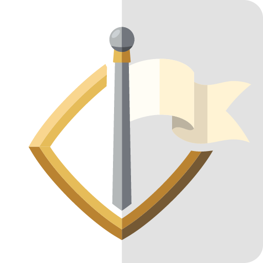

**[ParleyPort](https://github.com/junkerderprovinz/parleyport#readme)** · [Docker compose](https://github.com/junkerderprovinz/parleyport/blob/main/compose.yaml) 
Your own relay for apps that pair their instances: on different networks they meet there, and it passes on what it cannot read.

 

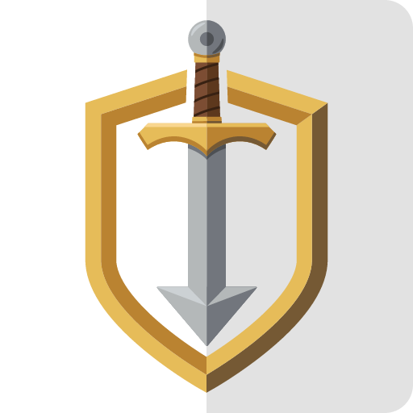

**[KnightLoader](https://github.com/junkerderprovinz/knightloader#readme)** · [Docker compose](https://github.com/junkerderprovinz/knightloader/blob/main/compose.yaml) 
Self-hosted download manager for hosters, debrid, torrents, Usenet and video, with an Android app and a browser extension.

 

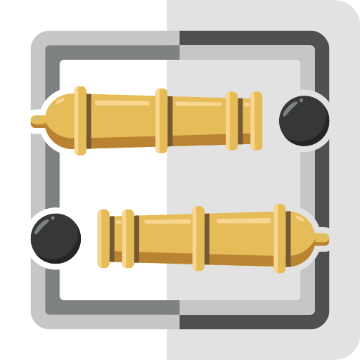

**[CannonCommander](https://github.com/junkerderprovinz/cannoncommander#readme)** · [Docker compose](https://github.com/junkerderprovinz/cannoncommander/blob/main/compose.yaml) 
The most beautiful file manager you will ever run, and the only one you need: two panels, F5 to copy, jobs in the background and a trash for second thoughts.

 

## Images

*My own custom image builds of third-party apps. Full docs in each app's own repository.*

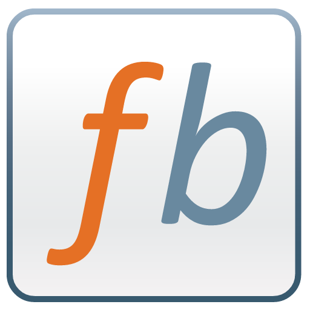

**[FileBot](https://github.com/junkerderprovinz/filebot#readme)** · [Docker compose](https://github.com/junkerderprovinz/filebot/blob/main/compose.yaml) 
The FileBot media renamer in your browser on a fast Selkies web desktop, dark from the first start. Bring your own FileBot license.

 

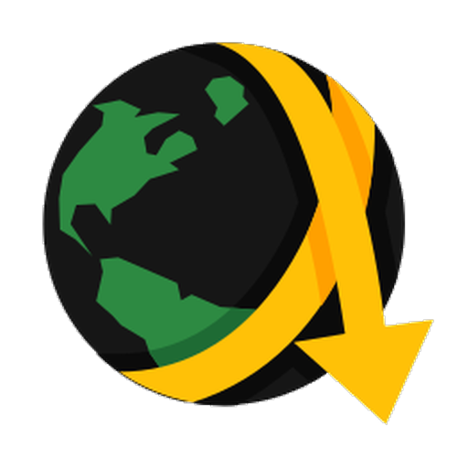

**[JDownloader](https://github.com/junkerderprovinz/jdownloader#readme)** · [Docker compose](https://github.com/junkerderprovinz/jdownloader/blob/main/compose.yaml) 
JDownloader 2 with a complete, sleek dark UI out of the box, on a fast Selkies web desktop in your browser. No VNC client, no install.

 

**[Krusader](https://github.com/junkerderprovinz/krusader#readme)** · [Docker compose](https://github.com/junkerderprovinz/krusader/blob/main/compose.yaml) 
Twin-pane KDE file manager with a native dark theme on a fast Selkies web desktop, with Kate, krename and RAR built in.

 

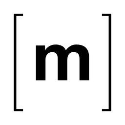

**[Matrix](https://github.com/junkerderprovinz/matrix#readme)** · [Docker compose](https://github.com/junkerderprovinz/matrix/blob/main/compose.yaml) 
A complete Matrix homeserver in one container: Synapse, coturn, Element Web and the Ketesa admin UI, with optional TURN over TLS.

 

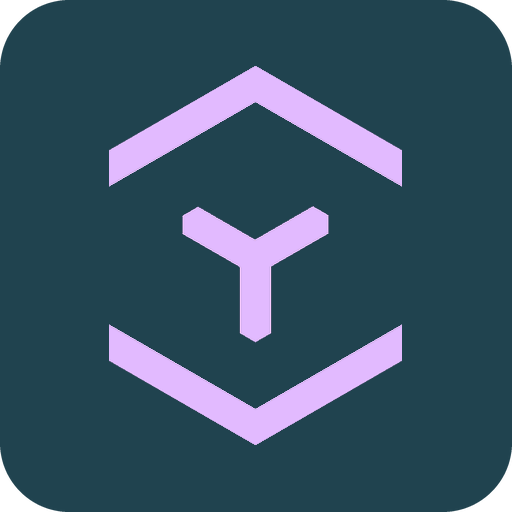

**[OpenCloud](https://github.com/junkerderprovinz/opencloud#readme)** · [Docker compose](https://github.com/junkerderprovinz/opencloud/blob/main/compose.yaml) 
One-click OpenCloud file sync &amp; share: auto-runs init, heals appdata permissions and honours PUID/PGID.

 

**[PrusaSlicer](https://github.com/junkerderprovinz/prusaslicer#readme)** · [Docker compose](https://github.com/junkerderprovinz/prusaslicer/blob/main/compose.yaml) 
The PrusaSlicer 3D-printing slicer in your browser on a fast Selkies web desktop: slice and export G-code, no VNC client (amd64 + arm64).

 

**[Stellarium](https://github.com/junkerderprovinz/stellarium#readme)** · [Docker compose](https://github.com/junkerderprovinz/stellarium/blob/main/compose.yaml) 
The Stellarium planetarium in your browser on a fast Selkies web desktop: pan the sky, zoom a nebula, scrub through time, no VNC client.

 

**[Garage](https://github.com/junkerderprovinz/garage#readme)** · [Docker compose](https://github.com/junkerderprovinz/garage/blob/main/compose.yaml) 
Garage's S3-compatible object store and its web admin panel in one container, with the single-node layout and S3 keys created automatically.

 

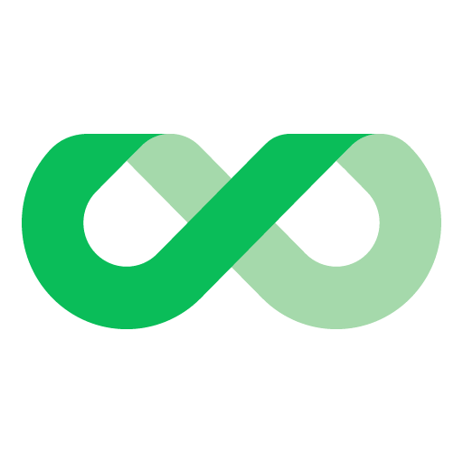

**[JuiceFS](https://github.com/junkerderprovinz/juicefs#readme)** · [Docker compose](https://github.com/junkerderprovinz/juicefs/blob/main/compose.yaml) 
The JuiceFS S3 gateway, with the file system created on first boot. Metadata goes to a database, file contents to an object store.

 

**[Euro Office](https://github.com/junkerderprovinz/euro-office#readme)** · [Docker compose](https://github.com/junkerderprovinz/euro-office/blob/main/compose.yaml) 
Sovereign, OnlyOffice-compatible document server for browser editing of Office and OpenDocument files, wired into OpenCloud over WOPI.

 

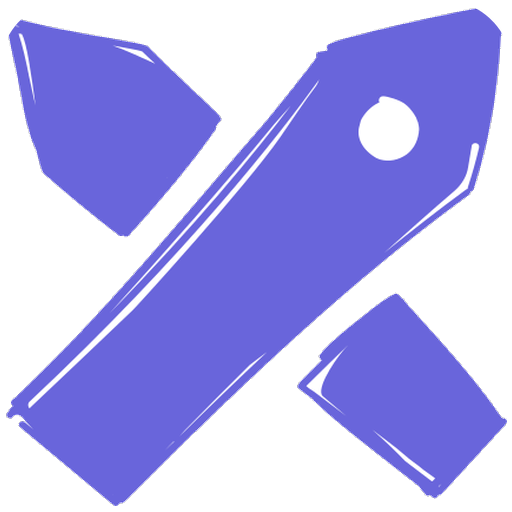

**[Excalidraw](https://github.com/junkerderprovinz/excalidraw#readme)** · [Docker compose](https://github.com/junkerderprovinz/excalidraw/blob/main/compose.yaml) 
The hand-drawn whiteboard, built so it keeps to itself: shared links, live collaboration, the session scene and even the fonts all come from your own server.

 

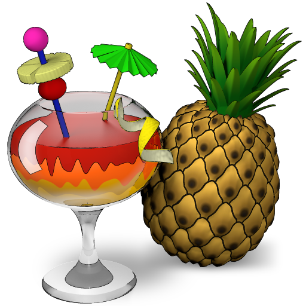

**[HandBrake](https://github.com/junkerderprovinz/handbrake#readme)** · [Docker compose](https://github.com/junkerderprovinz/handbrake/blob/main/compose.yaml) 
HandBrake's full GUI on a fast Selkies web desktop, GPU-accelerated on NVIDIA, Intel and AMD, with a watch folder that converts on its own.

 

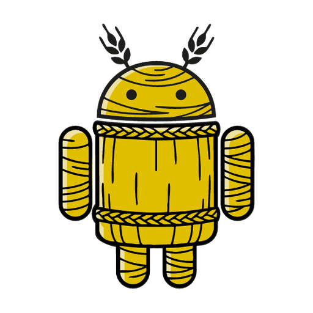

**[StrawDroid](https://github.com/junkerderprovinz/strawdroid#readme)** 
The real Android emulator on a Selkies web desktop, reached over adb like a phone on a cable, where Doze and background limits actually fire.

 

**[Seafile](https://github.com/junkerderprovinz/seafile#readme)** · [Docker compose](https://github.com/junkerderprovinz/seafile/blob/main/compose.yaml) 
The official Seafile server from one template, with its secrets generated on first start and MariaDB, Redis and the notification server built in on request.

 

**[Securo](https://github.com/junkerderprovinz/securo#readme)** · [Docker compose](https://github.com/junkerderprovinz/securo/blob/main/compose.yaml) 
The Securo finance manager with its worker and scheduler in one container, on your own PostgreSQL and Redis or on built-in ones.

 

**[RustDesk](https://github.com/junkerderprovinz/rustdesk#readme)** · [Docker compose](https://github.com/junkerderprovinz/rustdesk/blob/main/compose.yaml) 
Your own RustDesk server with a web console, accounts, an address book on every client and devices that can change their ID.

 

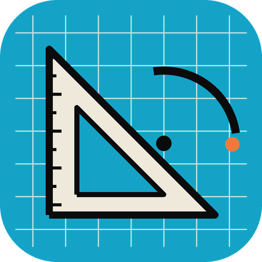

**[CADCraft](https://github.com/junkerderprovinz/artcraft-apps#cadcraft)** · [Docker compose](https://github.com/junkerderprovinz/artcraft-apps/blob/main/compose/cadcraft.yaml) 
CADCraft on a Selkies web desktop: 2D drafting with layers, blocks and dimensions, and DXF and DWG files, all in the browser.

 

**[DeckCraft](https://github.com/junkerderprovinz/artcraft-apps#deckcraft)** · [Docker compose](https://github.com/junkerderprovinz/artcraft-apps/blob/main/compose/deckcraft.yaml) 
DeckCraft on a Selkies web desktop, for building and presenting PowerPoint decks from any browser.

 

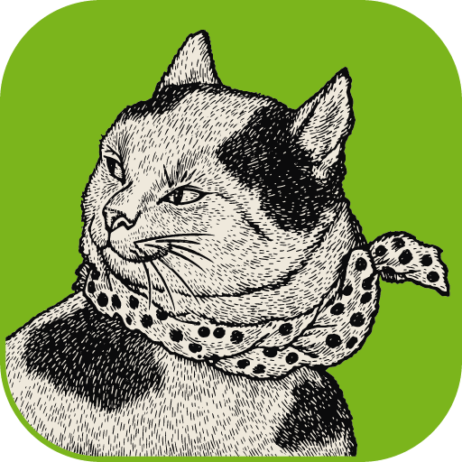

**[DesignCraft](https://github.com/junkerderprovinz/artcraft-apps#designcraft)** · [Docker compose](https://github.com/junkerderprovinz/artcraft-apps/blob/main/compose/designcraft.yaml) 
DesignCraft on a Selkies web desktop: lay out magazines and flyers in the browser and export print-ready PDFs.

 

**[EffectCraft](https://github.com/junkerderprovinz/artcraft-apps#effectcraft)** · [Docker compose](https://github.com/junkerderprovinz/artcraft-apps/blob/main/compose/effectcraft.yaml) 
EffectCraft on a Selkies web desktop, for motion graphics with compositions, keyframes and effects in the browser.

 

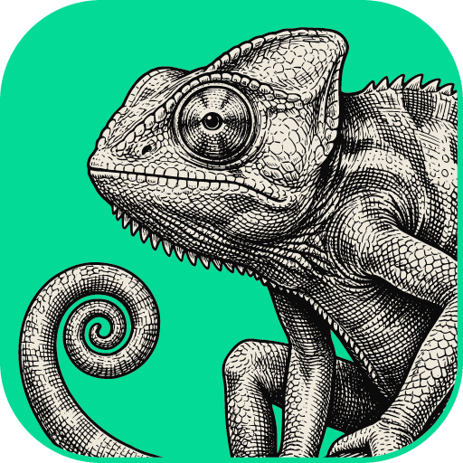

**[FigCraft](https://github.com/junkerderprovinz/artcraft-apps#figcraft)** · [Docker compose](https://github.com/junkerderprovinz/artcraft-apps/blob/main/compose/figcraft.yaml) 
FigCraft on a Selkies web desktop: design interfaces with frames and components and click through prototypes in the browser.

 

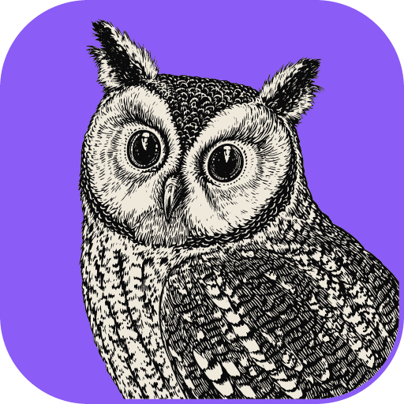

**[FilmCraft](https://github.com/junkerderprovinz/artcraft-apps#filmcraft)** · [Docker compose](https://github.com/junkerderprovinz/artcraft-apps/blob/main/compose/filmcraft.yaml) 
FilmCraft on a Selkies web desktop, a nonlinear video editor that cuts the footage on your array from any browser.

 

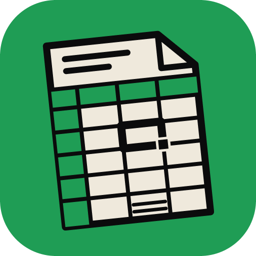

**[GridCraft](https://github.com/junkerderprovinz/artcraft-apps#gridcraft)** · [Docker compose](https://github.com/junkerderprovinz/artcraft-apps/blob/main/compose/gridcraft.yaml) 
GridCraft on a Selkies web desktop: a spreadsheet with formulas and charts that opens and saves Excel workbooks.

 

**[LightCraft](https://github.com/junkerderprovinz/artcraft-apps#lightcraft)** · [Docker compose](https://github.com/junkerderprovinz/artcraft-apps/blob/main/compose/lightcraft.yaml) 
LightCraft on a Selkies web desktop, a photo library and raw developer that sits right next to the photos on your array.

 

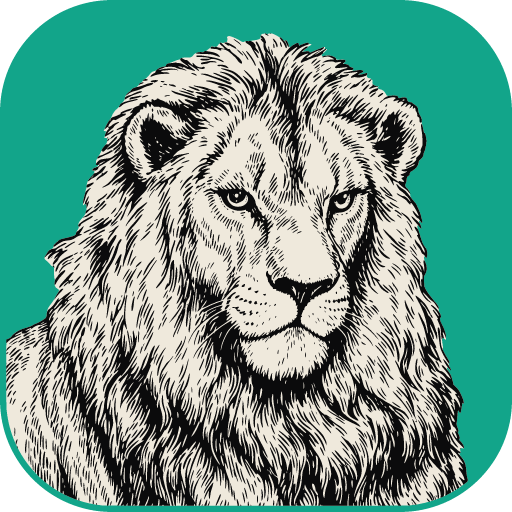

**[PdfCraft](https://github.com/junkerderprovinz/artcraft-apps#pdfcraft)** · [Docker compose](https://github.com/junkerderprovinz/artcraft-apps/blob/main/compose/pdfcraft.yaml) 
PdfCraft on a Selkies web desktop, for reading, editing, signing and running OCR on PDFs in the browser.

 

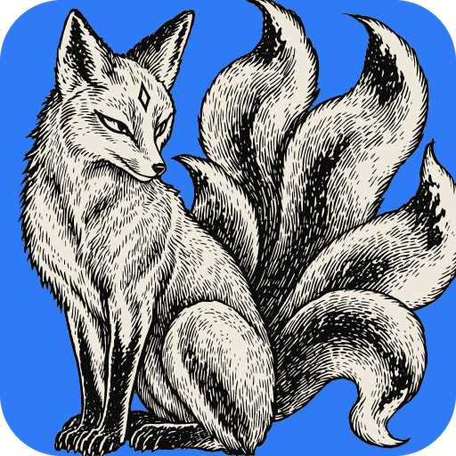

**[PhotoCraft](https://github.com/junkerderprovinz/artcraft-apps#photocraft)** · [Docker compose](https://github.com/junkerderprovinz/artcraft-apps/blob/main/compose/photocraft.yaml) 
PhotoCraft on a Selkies web desktop: a layered photo editor in the browser that opens PSD, Krita and Affinity files.

 

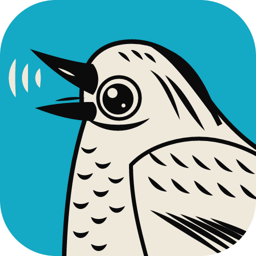

**[SoundCraft](https://github.com/junkerderprovinz/artcraft-apps#soundcraft)** · [Docker compose](https://github.com/junkerderprovinz/artcraft-apps/blob/main/compose/soundcraft.yaml) 
SoundCraft on a Selkies web desktop, a multitrack audio workstation whose sound plays in the browser.

 

**[VectorCraft](https://github.com/junkerderprovinz/artcraft-apps#vectorcraft)** · [Docker compose](https://github.com/junkerderprovinz/artcraft-apps/blob/main/compose/vectorcraft.yaml) 
VectorCraft on a Selkies web desktop: vector illustration with paths and type, SVG and PDF in and out.

 

**[WordCraft](https://github.com/junkerderprovinz/artcraft-apps#wordcraft)** · [Docker compose](https://github.com/junkerderprovinz/artcraft-apps/blob/main/compose/wordcraft.yaml) 
WordCraft on a Selkies web desktop, a word processor in the browser that opens and saves Word documents.

 

## Wrappers

*Thin templates over a third-party upstream image (no custom build). Full docs in each app's folder below.*

**[Claper](claper/README.md)** · [Docker compose](https://github.com/junkerderprovinz/unraid-apps/blob/main/claper/compose.yaml) 
Open-source, self-hosted Mentimeter/Slido alternative: live polls, Q&amp;A and quizzes alongside your slides, audience joins from their own device, no app install.

 

**[CouchDB](couchdb/README.md)** · [Docker compose](https://github.com/junkerderprovinz/unraid-apps/blob/main/couchdb/compose.yaml) 
The HTTP/JSON document database behind Obsidian LiveSync, on the official 3.x image with data, config and CORS mapped so they survive a recreate or update.

 

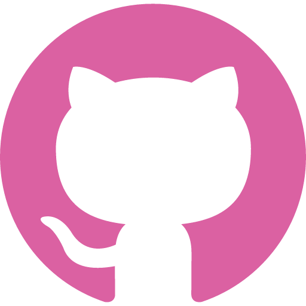

**[GitHub-Runner](https://github.com/junkerderprovinz/github-runner#readme)** · [Docker compose](https://github.com/junkerderprovinz/github-runner/blob/main/compose.yaml) 
Self-hosted GitHub Actions runners for several repositories of a personal account in one container, removed from GitHub again when it stops.

 

**[n8n](n8n/README.md)** · [Docker compose](https://github.com/junkerderprovinz/unraid-apps/blob/main/n8n/compose.yaml) 
Workflow automation connecting 400+ apps and APIs, on PostgreSQL by default, with every option exposed in the Unraid template form.

 

**[OpenHands](openhands/README.md)** · [Docker compose](https://github.com/junkerderprovinz/unraid-apps/blob/main/openhands/compose.yaml) 
Open-source AI software-development agent, pre-wired for a local Ollama model, so it reads, writes and runs code with no cloud account.

 

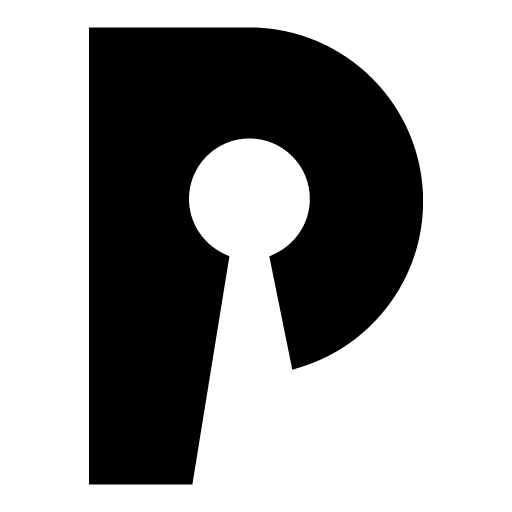

**[Pocket ID](pocket-id/README.md)** · [Docker compose](https://github.com/junkerderprovinz/unraid-apps/blob/main/pocket-id/compose.yaml) 
Passkey login for every app on your server that speaks OpenID Connect, with users, groups and an audit log, on SQLite or PostgreSQL.

 

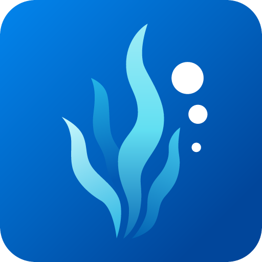

**[SeaweedFS](seaweedfs/README.md)** · [Docker compose](https://github.com/junkerderprovinz/unraid-apps/blob/main/seaweedfs/compose.yaml) 
Fast, S3-API-compatible object store on the official image, the actively-maintained alternative now that MinIO's open edition is done.

 

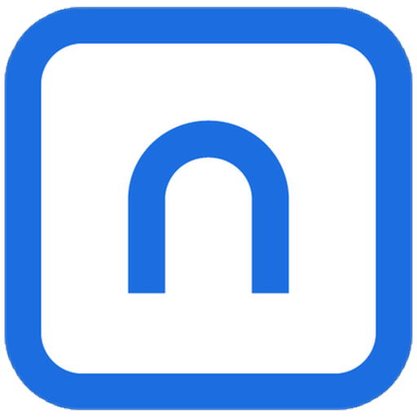

**[Standard Notes Server](standardnotes-server/README.md)** 
Self-hosted Standard Notes sync server (external MariaDB + Redis), with an optional LocalStack template for S3-compatible storage.

 

**[Standard Notes Web UI](standardnotes-webui/README.md)** · [Docker compose](https://github.com/junkerderprovinz/unraid-apps/blob/main/standardnotes-webui/compose.yaml) 
The official Standard Notes web client, self-hosted next to your own sync server for end-to-end encrypted notes in the browser.

 

**[VersityGW](versitygw/README.md)** · [Docker compose](https://github.com/junkerderprovinz/unraid-apps/blob/main/versitygw/compose.yaml) 
An S3 API in front of a share you already have: top-level folders become buckets, and every file stays readable over SMB and NFS at the same time.

 

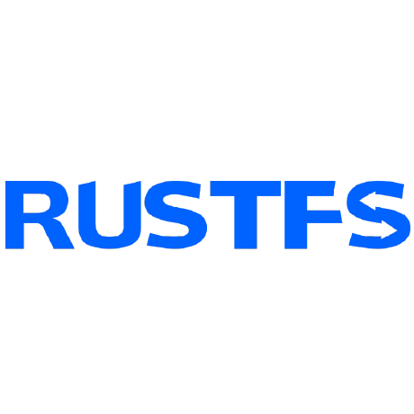

**[RustFS](rustfs/README.md)** · [Docker compose](https://github.com/junkerderprovinz/unraid-apps/blob/main/rustfs/compose.yaml) 
An S3 object store in Rust, with the two fixes it needs to run on Unraid at all. Pre-release: every version so far is a release candidate.

 

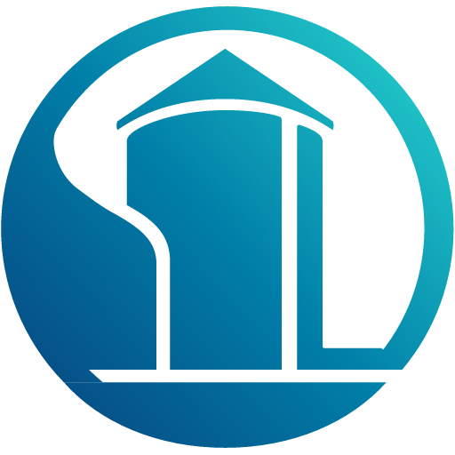

**[Silo](silo/README.md)** · [Docker compose](https://github.com/junkerderprovinz/unraid-apps/blob/main/silo/compose.yaml) 
MinIO, still maintained: PGSTY's fork of the open-source server, with the full web console. It reads an existing MinIO data folder as it is.

 

## Plugins

*Unraid **plugins** (not containers), listed on CA, installed from the Plugins tab via a `.plg` URL.*

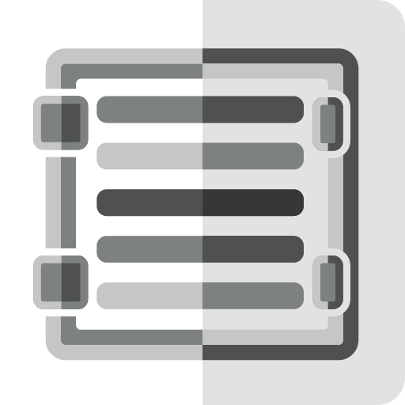

**[BombVault Widget](https://github.com/junkerderprovinz/bombvault-widget#readme)** 
BombVault's activity log as a real, native tile on the Unraid dashboard: every backup, restore, prune and drill live. Requires 6.9.0+.

 

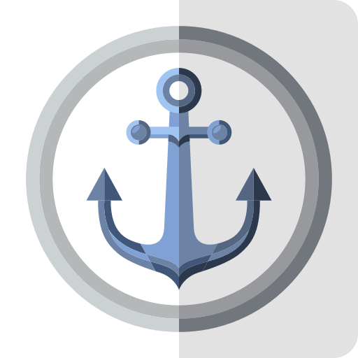

**[ShipLog](https://github.com/junkerderprovinz/shiplog#readme)** 
An update advisor in Unraid's Docker tab that shows what changes, how risky it is and which known vulnerabilities an update closes, with an optional auto-update that backs up first.

 

**[FireSquire](https://github.com/junkerderprovinz/firesquire#readme)** 
A pre-reboot health check returning one clear GO / CAUTION / NO-GO verdict before you reboot, so you never reboot into a landmine.

 

**[TowerTorch](https://github.com/junkerderprovinz/towertorch#readme)** 
A fully revamped, modern interface for your whole Unraid server, plus containers that start in the right order once each is really ready.

 

## Install

On Unraid: open **Apps** (Community Applications) and search for the app name. These templates are published from this repository.

To add a single template by hand, paste its raw `*.xml` URL into **Add Container → Template**, e.g.
`https://raw.githubusercontent.com/junkerderprovinz/unraid-apps/main/openhands/openhands.xml`

Apps and Images link to their dedicated repository's README; Wrappers keep their README in their folder here.

**Plugins** (BombVault Widget, ShipLog, FireSquire, TowerTorch) are published from this repository too. CA lists them the same way as containers (a template with `<Plugin>True</Plugin>` + `<PluginURL>`), so search for them in **Apps**. You can also install a plugin directly from **Plugins → Install Plugin** with its raw `.plg` URL, e.g.
`https://raw.githubusercontent.com/junkerderprovinz/firesquire/main/plugin/firesquire.plg`

## How AI is used here

One knight builds this, and AI is one of the tools I work with, the same way I work with an editor or a compiler. It helps me write code and documentation and it checks my work, and that saves me a good many evenings. It does not make the decisions, though. I read and understand everything before it ships, and if something here breaks, that is on me and not on the tool.

You do not have to take my word for it. The code is open and every release note is written by hand. The issue tracker shows how problems actually get handled, including the ones I got wrong the first time. If you find something that is not right, open an issue and I will look at it.

## Support

A one-knight job: I build them, keep them running, work through the issues and add what people ask for, until nothing is missing. They are free, with no accounts, no telemetry, no ads and no paid tier. No asterisk anywhere. Nothing readable ever leaves your own walls. Forged on evenings and weekends, with heart and stubbornness.

If one of these has earned a place on your server or computer, toss a coin to your knight: it helps cover the costs and keeps the project alive. It also makes this knight's heart beat a little faster. Three ways below, whichever suits you.

  
  
  

